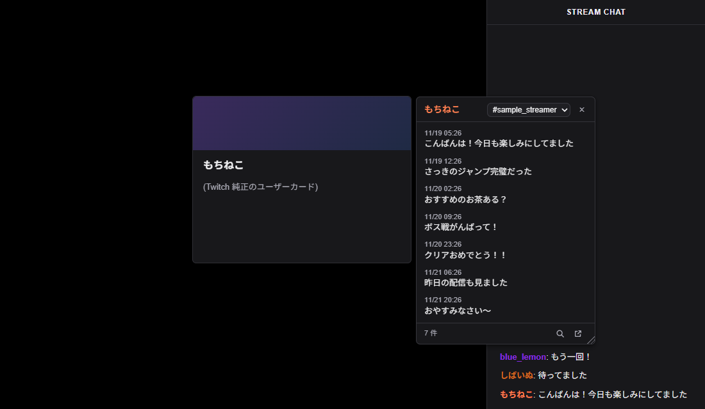
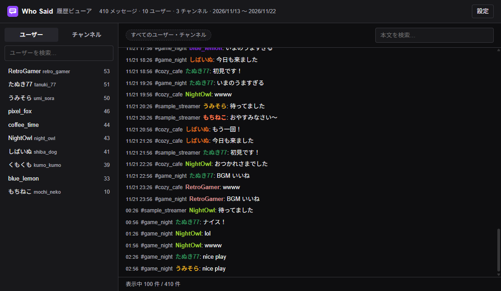

# Who Said — Twitch Chat History

Twitch のチャット欄でユーザー名をクリックすると、そのユーザーの過去の発言を横に表示する Chrome 拡張です。

- 自分が見たライブ / VOD のチャットを端末内(IndexedDB)に貯めて検索します
- 外部サーバーなし。データはどこにも送りません(エモート画像だけ Twitch の CDN から読み込みます)

> 自分用に作ったツールで、ストアでは配布していません。他の人の発言を端末に保存するため(既定で 365 日)、使う場合は Twitch の規約と周囲への配慮を確認し、取得したデータを公開・共有しないでください。保存期間の変更や全削除は設定画面からできます。



ツールバーのアイコンから、貯めた全データを見られる履歴ビューアを開けます。




## インストール

```sh
npm install
npm run build
```

`chrome://extensions` でデベロッパーモードを ON にし、「パッケージ化されていない拡張機能を読み込む」で `dist/` を選びます。

## 開発

```sh
npm run dev          # HMR 付きビルド
npm run check        # lint・型チェック・ユニットテスト
npm run smoke -- <channel>  # 実際の Twitch で動作確認
npm run screenshots  # README の画像を架空データで撮り直す
```

`smoke` と `screenshots` には Chrome for Testing が必要です。

```sh
npx @puppeteer/browsers install chrome@stable --path .cache/puppeteer
```

仕様は [docs/SPEC.md](docs/SPEC.md) にあります。

## ライセンス

MIT © rou39
