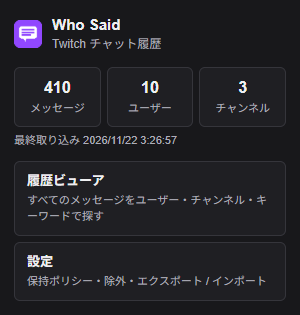

# Who Said — Twitch Chat History

Twitch のチャット欄でユーザー名をクリックすると、そのユーザーの過去の発言を横に表示する Chrome 拡張です。

- 自分が見たライブ / VOD のチャットを端末内(IndexedDB)に貯めて検索します
- 外部サーバーなし。データはどこにも送りません(エモート画像だけ Twitch の CDN から読み込みます)

> 自分用に作ったツールで、ストアでは配布していません。他の人の発言を端末に保存するため(既定で 365 日)、使う場合は Twitch の規約と周囲への配慮を確認し、取得したデータを公開・共有しないでください。保存期間の変更や全削除は設定画面からできます。


ツールバーのアイコンから、貯めた全データを見られる履歴ビューアを開けます。




## インストール

1. [最新版のページ](https://github.com/kuronekorou39/twitch-who-said/releases/latest)から zip をダウンロードし、右クリック →「すべて展開」でフォルダを取り出す
2. 取り出したフォルダを、消さない場所に置く(拡張機能はこのフォルダから読み込まれ続けます)
3. Chrome のアドレスバーに `chrome://extensions` と入れて開く
4. 右上の「デベロッパー モード」を ON にする
5. 左上の「パッケージ化されていない拡張機能を読み込む」を押して、2 のフォルダを選ぶ

### 更新

新しい zip を展開して中身を同じフォルダに上書きし、`chrome://extensions` で Who Said の再読み込みボタンを押します。自動では更新されません。

履歴はこの操作では消えません。**拡張機能を「削除」すると履歴も消える**ので、削除する場合は先に設定画面からエクスポートしてください。

## 開発

ソースからビルドする場合は次を実行し、`dist/` を読み込みます。

```sh
npm install
npm run build
```

```sh
npm run dev          # HMR 付きビルド
npm run check        # lint・型チェック・ユニットテスト
npm run smoke -- <channel>  # 実際の Twitch で動作確認
npm run screenshots  # README の画像を架空データで撮り直す
npm run release      # 配布用 zip を release/ に作る(-- --publish で GitHub Releases に公開)
```

`smoke` と `screenshots` には Chrome for Testing が必要です。

```sh
npx @puppeteer/browsers install chrome@stable --path .cache/puppeteer
```

仕様は [docs/SPEC.md](docs/SPEC.md) にあります。

## ライセンス

MIT © rou39
